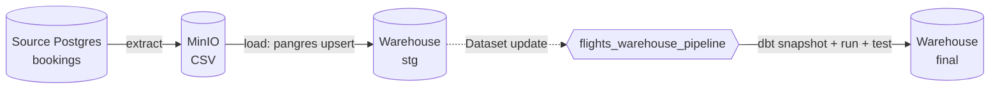
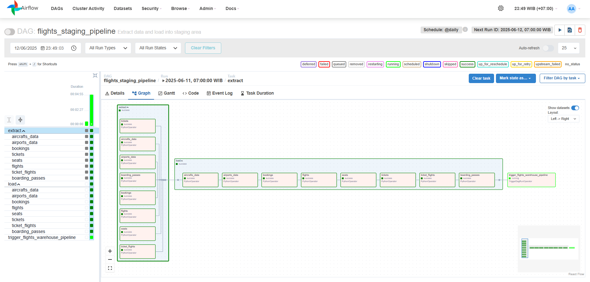
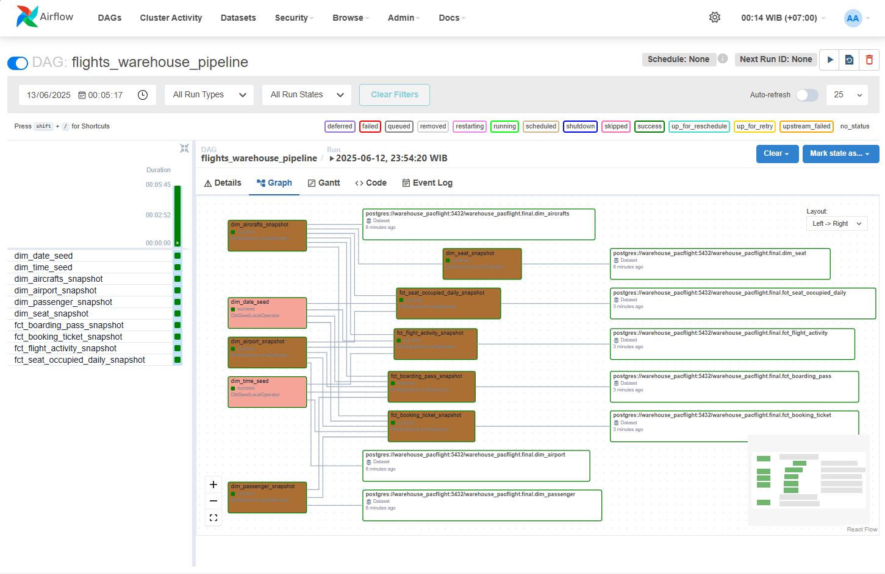
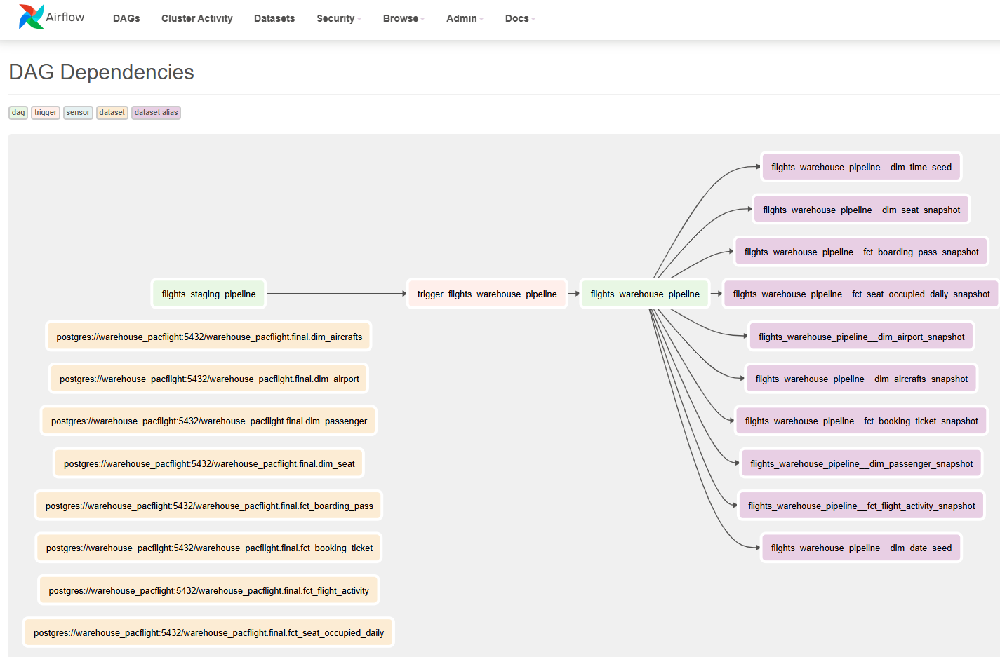
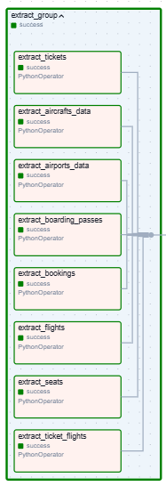
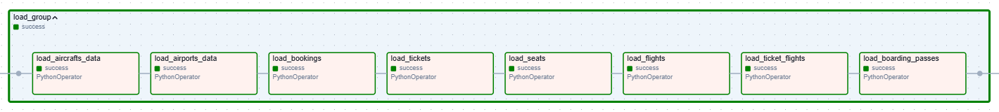
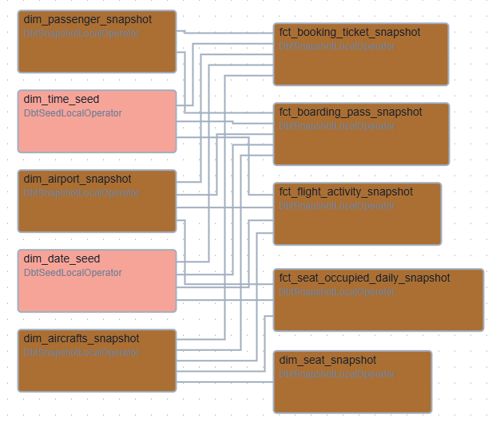
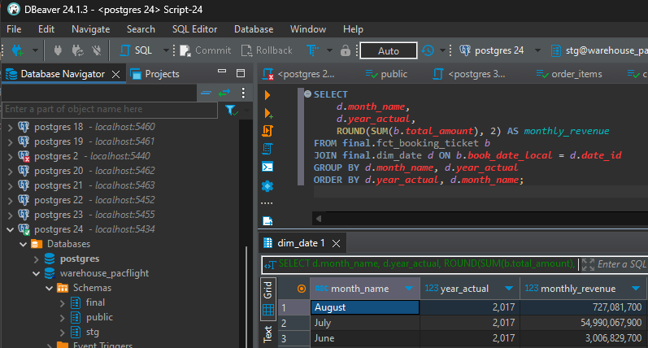
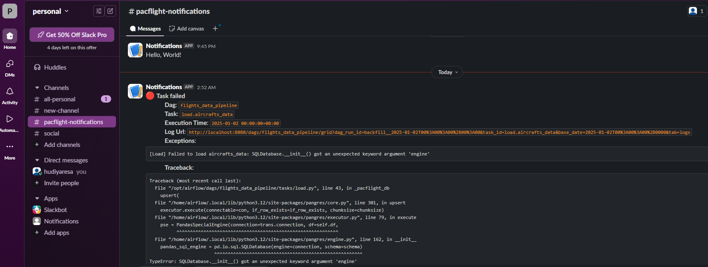
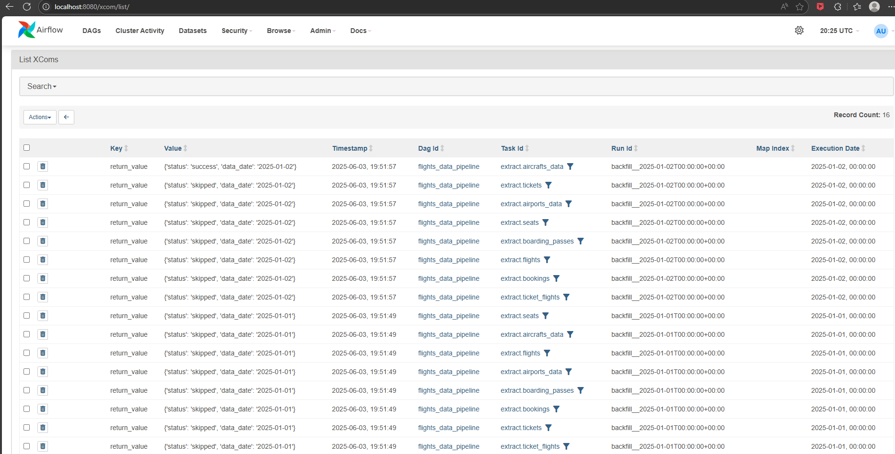

# Pac-Flights Data Pipeline with dbt

[](https://github.com/hudiyaresa/airflow-dbt-flightdata/actions/workflows/ci.yml)

An Airflow and dbt pipeline for a flight booking system. One DAG pulls the source tables into a staging schema. When it finishes, it updates an Airflow Dataset, and that Dataset schedules a second DAG where Astronomer Cosmos runs the dbt project: SCD2 snapshots for the dimensions, table models for the facts, and a dbt test after every node.

This is the third project in a small series:

1. [airflow-elt-flightdata](https://github.com/hudiyaresa/airflow-elt-flightdata): full load, plain SQL transforms
2. [airflow-incremental-flightdata](https://github.com/hudiyaresa/airflow-incremental-flightdata): incremental load, upserts, Slack alerts
3. **airflow-dbt-flightdata** (this repo): transforms moved to dbt, two DAGs linked by a Dataset

## Table of Contents

1. [What changed from the incremental version](#what-changed-from-the-incremental-version)
2. [Architecture](#architecture)
3. [The two DAGs](#the-two-dags)
4. [dbt project](#dbt-project)
5. [Project Structure](#project-structure)
6. [Getting Started](#getting-started)
7. [Testing and CI](#testing-and-ci)
8. [Screenshots](#screenshots)

## What changed from the incremental version

| | Incremental (repo 2) | dbt (this repo) |
| --- | --- | --- |
| Transform | SQL files run by `SQLExecuteQueryOperator` | dbt project rendered as Airflow tasks by Cosmos |
| Dimensions | overwritten by upsert | SCD2 snapshots, history kept in `dbt_valid_from` / `dbt_valid_to` |
| Facts | upsert SQL | dbt table models joined to the current dimension rows |
| Data checks | none | 35 dbt tests (keys, grain, relationships, ranges) after every node |
| DAG link | one DAG | staging DAG updates a Dataset, warehouse DAG is scheduled on it |
| Executor | LocalExecutor | CeleryExecutor with Redis |

## Architecture

| Layer | Tool | Notes |
| --- | --- | --- |
| Source | PostgreSQL 16 | `bookings` schema (Pacflight airline demo data) |
| Data lake | MinIO | CSV per table in `extracted-data` |
| Staging | PostgreSQL 16 | `stg` schema, filled with `pangres` upserts |
| Transform | dbt 1.8 + dbt_utils | runs from its own virtualenv, builds the `final` schema |
| Orchestrator | Apache Airflow 2.10.2 | CeleryExecutor, Astronomer Cosmos 1.7 for dbt |
| Alerting | Slack webhook | `on_failure_callback` on every task in both DAGs |
| Runtime | Docker Compose | one command brings everything up |



## The two DAGs

### flights_staging_pipeline

Runs `@daily`.

| Step | What it does |
| --- | --- |
| `extract` | One task per table. Writes a CSV to MinIO and pushes its status to XCom, or skips when there is nothing new. |
| `load` | Skips when extract skipped. Otherwise upserts the CSV into `stg` with the primary keys from the `tables_to_load` Variable. Tables load parents first so foreign keys hold. |
| `publish_staging` | Marks the `stg` Dataset as updated. |

Set the Variable `incremental` to `true` to pull only the rows created or updated inside the run's `[data_interval_start, data_interval_end)`. The bounds are passed to Postgres as query parameters, and extract and load build the same MinIO object name from `data_interval_start` (`tasks/components/window.py`). The incremental logic is explained in more detail in [repo 2](https://github.com/hudiyaresa/airflow-incremental-flightdata#how-the-incremental-window-works).

### flights_warehouse_pipeline

A Cosmos `DbtDag` with `schedule=[STG_DATASET]`, so it starts by itself whenever staging finishes. It does not run on a timer. Every dbt node becomes a task group with a `run` (or `snapshot`) task followed by a `test` task, so a failing test stops the downstream models before they read bad data.

Earlier versions used a `TriggerDagRunOperator` with `wait_for_completion=True`, which kept a worker slot busy for the whole dbt run. With the Dataset, Airflow shows the link between the two DAGs in the Datasets view.

## dbt project

```text
pacflight_dbt/
├── models/
│   ├── staging/_sources.yml      stg tables + key tests on the raw data
│   └── marts/                    fct_* table models + grain and relationship tests
├── snapshots/                    dim_* SCD2 snapshots + current-row key tests
├── seeds/                        dim_date, dim_time
├── packages.yml                  dbt_utils
└── dbt_project.yml
```

| Node | Type | Grain |
| --- | --- | --- |
| `dim_aircrafts`, `dim_airport`, `dim_passenger`, `dim_seat` | snapshot (check strategy) | one row per version of an entity |
| `dim_date`, `dim_time` | seed | one row per day / minute |
| `fct_flight_activity` | table | one row per flight |
| `fct_booking_ticket` | table | one row per booking, ticket and flight |
| `fct_boarding_pass` | table | one row per ticket and flight that boarded |
| `fct_seat_occupied_daily` | table | one row per arrived flight and day |

A note on the snapshot choice: before this version, the fact tables were also built as snapshots. That gave every fact row `dbt_valid_from` / `dbt_valid_to` columns it did not need, and it hid a bug: the facts joined the dimension snapshots without filtering on the current version. Once a dimension row changed, the join returned one fact row per version. The facts are now plain tables and every dimension join adds `dbt_valid_to IS NULL`. Only the dimensions, where history matters, stay snapshots.

### Tests

| Where | Tests |
| --- | --- |
| Sources | `unique` + `not_null` on every natural key, `dbt_utils.unique_combination_of_columns` on composite keys |
| Snapshots | `not_null` on the surrogate key, `unique` on it with `where: dbt_valid_to IS NULL`, seat to aircraft relationship |
| Marts | fact grain with `unique_combination_of_columns`, relationships to the dimensions, `accepted_range` on `amount` and `empty_seats` |

## Project Structure

```text
airflow-dbt-flightdata/
├── .github/workflows/ci.yml          lint, dbt parse and pytest on every push
├── dags/
│   ├── flights_staging_pipeline/
│   │   ├── run.py                    staging DAG, emits the Dataset
│   │   └── tasks/
│   │       ├── main.py               extract and load task groups
│   │       └── components/           extract.py, load.py, window.py
│   ├── flights_warehouse_pipeline/
│   │   ├── run.py                    Cosmos DbtDag scheduled on the Dataset
│   │   └── pacflight_dbt/            dbt project
│   └── helper/                       minio, postgres, datasets, slack callback
├── include/
│   ├── variables.json                incremental flag, table list, primary keys
│   └── connections.yaml              connection template (fill in the passwords)
├── data/warehouse/                   stg DDL
├── tests/                            pytest suite
├── docs/                             screenshots
├── .env.example
├── docker-compose.yml
├── Dockerfile                        Airflow + Cosmos, dbt in /opt/airflow/dbt_venv
├── dbt-requirements.txt
├── requirements.txt
├── requirements-dev.txt
└── start.sh
```

## Getting Started

### 1. Clone

```bash
git clone https://github.com/hudiyaresa/airflow-dbt-flightdata.git
cd airflow-dbt-flightdata
```

### 2. Add the source data

Put the Pacflight source dump (the `bookings` schema) at `data/source/init.sql`. Postgres runs it the first time the `pacflight_db` container starts. The file is ignored by git because of its size.

### 3. Configure the environment

```bash
cp .env.example .env
python fernet.py   # paste the output into AIRFLOW_FERNET_KEY
```

Change the passwords in `.env`, then put the same values in `include/connections.yaml`.

### 4. Start everything

```bash
chmod +x start.sh
./start.sh
```

The script builds the image, starts all services, waits until the webserver is healthy, and imports the Connections and Variables.

| Service | Address |
| --- | --- |
| Airflow UI | http://localhost:8080 (`airflow` / `airflow` unless set in `.env`) |
| MinIO console | http://localhost:9001 |
| Source DB | localhost:5440 |
| Warehouse DB | localhost:5441 |

### 5. Run it

Unpause both DAGs, then trigger `flights_staging_pipeline`. The warehouse DAG starts on its own when staging is done.

### 6. Slack alerts

1. Create an Incoming Webhook in a Slack app.
2. Put the webhook URL in the `password` field of the `slack_webhook` connection.
3. Failed tasks now post to `#pacflight-notifications` with the log URL and traceback.

## Testing and CI

```bash
pip install "apache-airflow==2.10.2" -r requirements.txt -r requirements-dev.txt \
  --constraint https://raw.githubusercontent.com/apache/airflow/constraints-2.10.2/constraints-3.10.txt
python -m venv dbt_venv && dbt_venv/bin/pip install -r dbt-requirements.txt
export DBT_EXECUTABLE_PATH=$PWD/dbt_venv/bin/dbt
export AIRFLOW_CONN_WAREHOUSE_PACFLIGHT=postgresql://ci:ci@localhost:5432/warehouse_pacflight
airflow db migrate
ruff check dags tests
pytest -v
```

| Check | Covers |
| --- | --- |
| `ruff check` | lint for DAGs and tests |
| `dbt deps` + `dbt parse` | the dbt project compiles, refs and tests resolve |
| `tests/test_dag_integrity.py` | both DAGs import, staging emits the Dataset, warehouse is scheduled on it and has dbt test tasks, `variables.json` matches the DAG defaults |
| `tests/test_window.py` | half open interval, parametrized query, object names per interval |

GitHub Actions runs all of these on every push and pull request. No database is needed: Cosmos only reads the connection to build a dbt profile.

## Screenshots

### DAGs





### Task groups

| Extract | Load | dbt |
| --- | --- | --- |
|  |  |  |

### Querying the warehouse



### Slack notification



### XComs between extract and load


